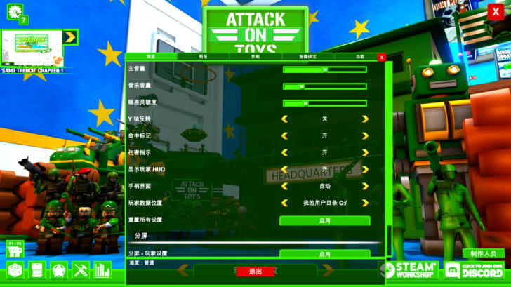
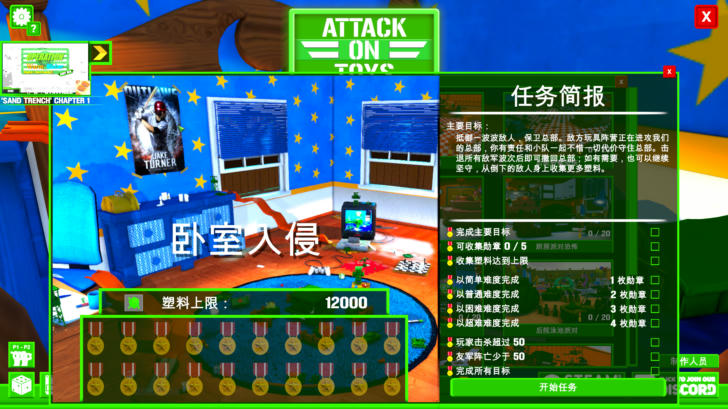

# 第一批翻译：菜单、设置、任务（2026-11-01）

## 范围与数量

| 文件 | 内容 | 条目 |
|---|---|---|
| `translation/zh-CN/01_ui_menu.tsv` | 启动页、主菜单、设置（常规/图形/性能/按键）、存档、小队升级、分屏、帮助 | 约 330 |
| `translation/zh-CN/02_ui_missions.tsv` | 任务选择、简报、模式说明、关卡名、战斗 HUD、玩具箱、创意工坊 | 约 200 |
| `translation/zh-CN/00_regex.tsv` | 动态拼接文本的正则规则 | 19 |

构建结果：529 条人工译文 + 180 条自动大写变体 + 19 条正则。所有原文键都能在提取的原文池中找到（`build_xunity.py` 会校验）。

## 游戏内验证

已在游戏里逐一确认：

- 启动页抢先体验说明 ✔
- 设置五个标签页、所有选项名和选项值 ✔（`难度：普通` 由 `sr:` 拆分规则翻译）
- 按键绑定（`点按：BUTTON A`、`长按：■`，鼠标键名）✔
- 帮助页 1245 字符的长文本 ✔ —— **`MaxCharactersPerTranslation=400` 不影响人工译文查找**
- 入侵任务选择卡片、任务简报、目标列表（`可收集勋章 0 / 5`、`1 枚勋章`）✔

## 排版规则（构建时自动处理）

Unity 旧版 Text 只在空格处断行。中文段落里夹一个空格（如 `PvP 与玩具箱`），后面整段中文会被当成一个"单词"，整体挤到下一行，留下难看的短行（见 `img/03_help_zh.jpg` 的 PvP 条目）。
`build_xunity.py` 的 `tighten()` 会去掉中文与英文/数字/® 之间的空格。写译文时可以照常加空格，构建会处理。

## 约定

- TSV 三列：`src`、`zh`、`note`，反斜杠转义（`\n` `\r` `\t` `\\`）。**不含 TAB 的行是注释**（因为原文里有 `# RANK` 这类以 # 开头的文本）。
- `zh` 留空 = 有意不翻（人名、按键名、占位符、制作人员名单）。
- 混合大小写的原文只写一次，构建时自动补全大写版本（游戏常把数据文本转成大写再显示）。
- 正则条目避免反斜杠，字面符号用字符类：`[.]` `[|]` `[*]` `[[]` `[]]`。

## 尚未覆盖

- 教程关（Attic Boot Camp）对话：在数据里是碎片（`Hey` + 名字 + `, Welcome to the bootcamp`），需要进关采集完整句子。
- 道具/兵种/玩具箱物品名（约 2,300 条，`ProfileDataScript`、`ToyBoxSystem`）。
- 战斗中 HUD、商店、物品栏、暂停菜单、结算界面。
- 两条动态多行文本：存档详情 `NAME: …\nTOY: …`、兵种属性 `DAMAGE: …\nRANGE: …`，需要正则。
