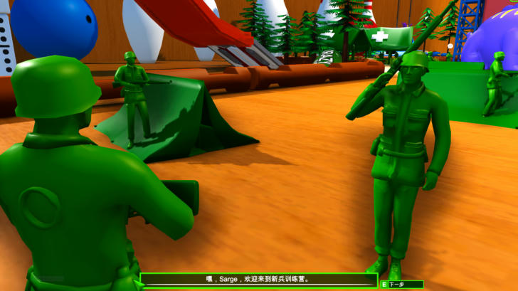
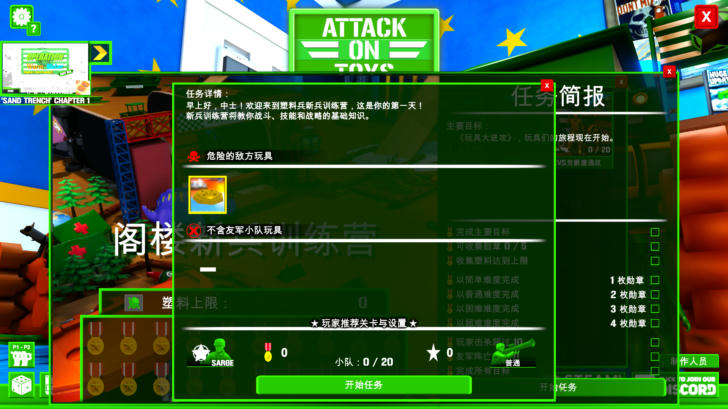
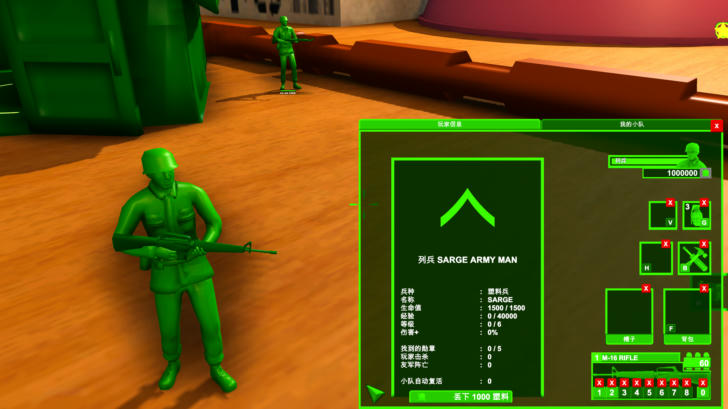

# 第二批翻译：训练营对话、HUD、物品栏、代码提示（2026-11-01）

## 新增内容

| 文件 | 内容 | 条目 |
|---|---|---|
| `03_bootcamp_dialog.tsv` | 阁楼新兵训练营全部 NPC 对话（单句） | 59 |
| `04_hud_runtime.tsv` | 战斗 HUD、存档/保存提示、排行榜、创意工坊上传提示、玩具箱分类、名牌里的兵种 | 约 75 |
| `00_regex.tsv` | 对话里的玩家名/按键插入、NPC 名牌、物品栏标题、存档详情、战斗提示、升级说明等 | 新增 61（共 80） |

构建结果：662 条人工译文 + 299 条大写变体 + 80 条正则。

## 关键发现

### 1. 对话的拼接格式（已实测）

训练营 NPC 对话显示为 `" " + 碎片 + [" " + 玩家名] + "."`：

- `" Proceed to every Bootcamp post to get training and guide."`：开头有空格，结尾由游戏补句号。
- `" Hey Sarge, Welcome to the bootcamp."`：`Hey` 条目带"追加玩家名"标记，后面再拼下一个碎片。
- `" Good Luck on your Training Sarge."`：句末追加玩家名。

`DialogBaseScript` 里每个字符串后面的整数是标记：`1` = 追加玩家名（11 句），`2` = 含义未明（4 句，目前只有精确匹配）。
因此单句的键是"碎片 + 句号"，带名字的句子用 `r:` 正则（名字原样保留，不翻译）。

### 2. 游戏会读回已翻译的文本再拼接

任务详情窗口的文字是游戏把简报控件的文本（此时已是中文）读回来，再拼上第二句英文：
`早上好，中士！……第一天！\nThe Army Boot Camp will teach you…`。

XUnity 的 `TextGetterCompatibilityMode` 在 IL2CPP 下不可用，所以加了一条通用拆分规则：
`sr:"^(?<head_i>[^A-Za-z]*[！。？])(?<tail>[^一-龥]*[A-Za-z][^一-龥]*)$"`：中文部分原样保留，只对英文尾巴查表。已实测有效。

### 3. 采集模式会破坏多行文本的显示（只影响开发）

采集用的回显服务收到的是 XUnity 去掉换行后的文本，原样返回后会被当成"译文"缓存。
游戏读回多行文本（物品栏数值列、制作人员名单）再赋值时，就被压成一行。
**发布模式不接翻译服务，不受影响**（已用发布配置实测：物品栏数值列保持多行对齐）。
结论：采集产生的 `_AutoGeneratedTranslations.txt` 绝不能随发布包分发；验证排版一律用发布配置。

### 4. 配置调整

两份配置都加了 `IgnoreWhitespaceInDialogue=False`。这个选项是为日文设计的，会对长文本做空白归一化；英文原文不需要，关掉后键与原文完全一致，更可控。

## 仍为英文

- 武器、兵种、建筑、道具名：`M-16 RIFLE`、`Jeep`、`Assault Man`、`Medic Tent`、`Army Tower Lv.3` 等，属于第三批。
- 标记为 `2` 的 4 句对话：如果游戏追加了什么内容，精确匹配会失败，需要实测。
- 训练营各岗位的 NPC 对话只实测了开头的 HQ 军官，其余按同一格式推导。
