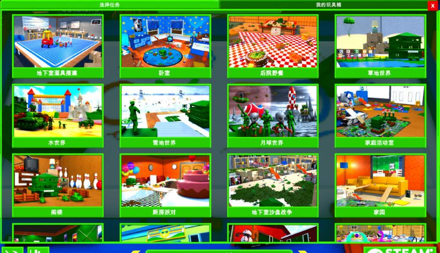
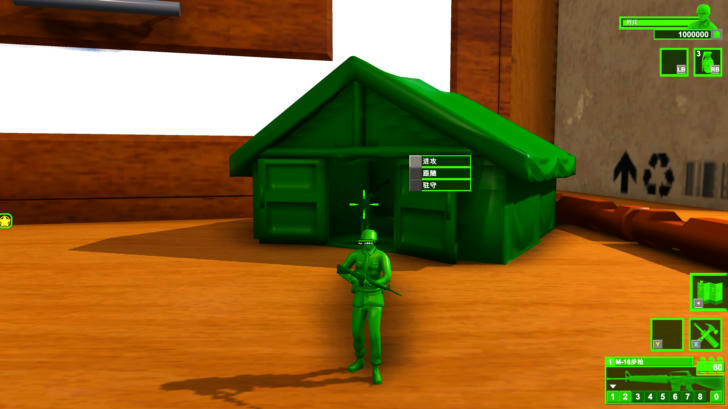

# 第三批翻译：兵种、武器、建筑、玩具箱物品与分类（2026-11-01）

## 来源

`scripts/extract_items.py` 从 `sharedassets0.assets` 的 `ProfileDataScript` 读出每个物品的名称和说明，按所在 GameObject 名的 `[XXX]` 前缀分类，写到 `translation/source/items.json`：

| 类别 | 数量 | 内容 |
|---|---|---|
| PROP | 1,588 | 玩具箱摆件（家具、玩具、食物、装饰、积木…），基本没有说明 |
| TROOP | 132 | 兵种、载具 |
| ITEM | 118 | 武器、帽子、背包、能力道具 |
| TOWER | 104 | 塔楼、建筑、生成建筑 |
| 其他 | 25 | 玩家角色、玩具桶、生成点、地雷、放大镜等 |
| 玩具箱分类 | 400 | `ToyBoxSystem` 的分类树 |

## 做法

1. `scripts/make_item_chunks.py` 把 2,660 条待译文本切成 5 块（`translation/todo/items_*.tsv`）。
2. 5 个子代理并行翻译，共用 `translation/glossary.md`（本批新增“玩具系列与兵种”一节），各自写 `translation/zh-CN/05_items_*.tsv`，并用 `scripts/check_chunk.py` 自检（原文列逐字节不变）。
3. `scripts/harmonize_terms.py` 统一子代理之间的术语差异（共改 139 行）。例如灯具点亮统一为“（亮）”，`Tamed` 统一为“驯服”，`Pool Float` 统一为“泳池浮排”，`WoodBlock-3` 统一为“数字木块 3”。以后再并行翻译时，这个脚本可以重复运行。

结果：已译 2,656 条，有意留空 4 条（纯型号 `CI-PHX`、`M163-AA`、`UFO-ZI-M`，西语玩笑 `amigos-amigos.`）。
构建总计 3,328 条人工译文 + 2,934 条大写变体 + 81 条正则，全部原文键都能在原文池找到。

## 新增规则

- `sr:"^(?<n>.+?) (?<lv_i>Lv[.] ?[0-9]+)$"`：带等级后缀的单位/建筑名，如 `Army Tower Lv.3` → `军用塔楼 Lv.3`。
- NPC 名牌的通用规则加了否定前瞻 `(?!(Pvt|…)[.] )`。实测发现它比带军衔的规则先匹配，把 `Pvt. Sarge` 整个当成名字，导致军衔没翻。**修复后尚未进游戏复测。**
- `translation/source/observed.txt`：截图里看到、但发布模式下不会被采集的原文（目前是玩具箱地图卡片的地名），构建校验会把它算进原文池。

## 游戏内验证

- 训练营武器栏：`M-16 RIFLE` → `M-16步枪` ✔
- NPC 名牌兵种：`:Rifle Man:` → `:步枪兵:` ✔（军衔见上）
- 玩具箱地图选择：全部卡片中文 ✔
- 玩具箱编辑器右侧面板 ✔；物品名不以悬停提示显示，没找到直接验证的位置

## 待确认

- 子代理标注的几处推测译法：`Pool Lamp`（台球灯还是泳池灯）、`Water Barrier`（水体屏障）、`Ability Left Primary Weapon`（能力武器）、迫击炮说明里的“掩体”一句。
- 原作文案错误照译：Alien 的说明写着 “Army Man Commando & Builder.”。
