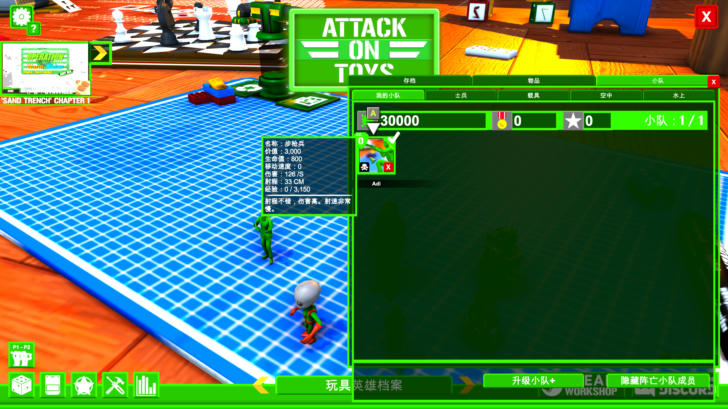
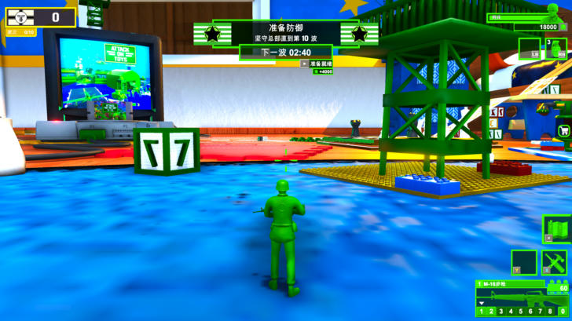

# 补漏：逐个界面采集与验证（2026-11-01）

## 本轮走查的界面

| 界面 | 结果 |
|---|---|
| 读取存档 / 读取游戏 | ✔ 已是中文（存档详情由多行正则翻译） |
| 玩具英雄档案（存档、物品商店、小队三页） | 补了“需要满级”；属性卡片补了正则 |
| 小队成员悬停卡、商店物品卡 | 补了 5 条属性卡片正则：`名称/价值/生命值/移动速度/伤害/射程/经验` |
| 我的模组 | ✔ |
| 排行榜（5 个标签页） | ✔ 表头中文，玩家名保留原样 |
| 分屏设置 | ✔ |
| 创意工坊推荐面板 | 补了“★ 建造者”和 `BY X → 作者：X`；社区作品标题保留原样 |
| 入侵战斗 HUD（准备阶段） | ✔ 准备防御 / 坚守总部直到第 N 波 / 下一波 / 准备就绪 / 波次 |
| 暂停菜单、退出确认 | ✔ |

## 不翻译、也无法翻译的

- **玩具英雄档案里的 `PLAYER NAME`**：它是输入框的占位文本。XUnity 会刻意跳过输入框里的文字，避免改动玩家输入，所以保留英文。
- **STEAM WORKSHOP 按钮**：打开的是 Steam 覆盖层里的网页，不属于游戏界面。
- **玩家内容**：排行榜玩家名、社区作品标题、YouTuber 名、存档名都保留原样。

## 没覆盖到的

- **战斗结算界面**：退出任务会直接回主菜单，要打完或打输一局才能看到。相关文本（MISSION COMPLETED / FAILED、REWARD x）已按静态文本翻译，还没实测。
- **战斗中的建造菜单**：只能用数字键操作，没有逐项悬停查看。
- **波次开始后的战斗提示**：例如"[!] 小队：X 倒下了！""X 升级了！"，正则已写好，还没实测。

## 工具改动

`build_xunity.py` 的原文池改为读取全部 `translation/source/runtime_autogen*.txt`（每轮采集各存一份）。
